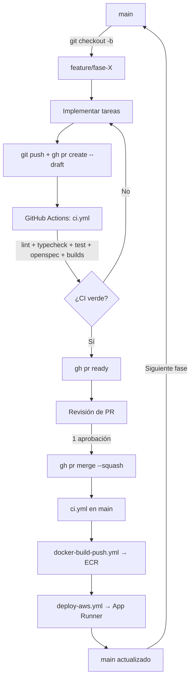

# AGENTS.md

## Descripción del proyecto

Sistema de reservas de club deportivo (MVP). Enfoque API-First: los contratos se definen en OpenSpec y luego se implementan.

- **Backend**: NestJS + TypeScript
- **Base de datos**: PostgreSQL 16 en Docker local y RDS PostgreSQL 16 en AWS (Supabase queda como alternativa histórica)
- **Especificaciones**: OpenSpec (`@fission-ai/openspec`) en `openspec/`
- **Frontend**: Next.js 16 + React 19 + Tailwind 4
- **Infraestructura**: Docker + AWS (App Runner, RDS, ECR, Terraform)

## Comandos

```bash
# Instalación en raíz (ejecuta prisma skills sync)
pnpm install

# Backend (NestJS)
cd backend && pnpm run start:dev

# Tests, lint y typecheck (backend)
cd backend && pnpm run test
cd backend && pnpm run test:e2e
cd backend && pnpm run lint
cd backend && pnpm run typecheck

# OpenSpec
pnpm exec openspec validate --all --strict

# Docker (stack completo)
docker compose up -d --build
docker compose ps

# Smoke test de un despliegue
./scripts/smoke-test.sh http://localhost:3001

# Terraform (infra/terraform)
terraform fmt -check -recursive && terraform validate

# GitHub CLI — gestión de fases
gh pr list --label "feature"                          # Ver PRs de features activos
gh run list --branch main --limit 5                   # Últimos CI runs en main
./scripts/phase-workflow.sh <num> <nombre> <slug>     # Iniciar nueva fase (crea issue + rama + PR draft)
```

**Scripts disponibles en `backend/package.json`:** `test`, `test:e2e`, `lint`, `typecheck`.  
**Workflows de CI en `.github/workflows/`:** `ci.yml` (lint + typecheck + test + openspec + builds), `docker-build-push.yml` (ECR) y `deploy-aws.yml` (App Runner).

## Arquitectura

- **API-First**: definir specs en `openspec/specs/` antes de escribir código. Usar las skills de OpenSpec (`openspec-new-change`, `openspec-propose`, etc.) para impulsar el flujo de trabajo.
- **El esquema de base de datos es el código fuente autoritativo** hoy: `backend/db/esquema-final.sql` (1968 líneas). Las reglas de negocio se ejecutan via triggers de PostgreSQL, no en la aplicación.
- **Docker**: `backend/Dockerfile` y `frontend/Dockerfile` multi-stage (contexto de build: raíz del monorepo); `docker-compose.yml` levanta db + api + web.
- **Infraestructura AWS**: `infra/terraform/` (VPC, RDS, ECR, IAM, App Runner, Route53 y alarmas). Guía en `docs/despliegue-aws.md`.
- **Contexto OpenSpec**: `openspec/config.yaml` define dominio, roles y reglas de negocio.

## Reglas clave de negocio (de los triggers)

- La reserva pertenece exactamente a una `Persona` (un `Usuario` o un invitado sin cuenta).
- Máximo 2 reservas `CONFIRMADA` por `Usuario` (advisory lock).
- La cancelación requiere 1 día de anticipación para reservas de autoservicio (`AUTOGESTIONADA`).
- Alquiler de equipamiento: stock se decrementa al insertar, se restaura al devolver/cancelar.
- 3+ infracciones de equipamiento → suspensión automática.
- `registros_auditoria` es solo-append (REVOKE UPDATE/DELETE).
- RLS habilitado en todas las tablas (hoy inerte: la app conecta como dueña de las tablas, sin policies).

## Convenciones

- **Idioma**: español para nombres de dominio, tablas, columnas y comentarios de código.
- **IDs**: UUIDs (pgcrypto `gen_random_uuid()`).
- **Bajas lógicas**: columna `estado` (`ACTIVO`/`INACTIVO`) + `inactivated_at`. No hay borrados físicos en entidades principales.
- **Timestamps**: `creado_en` / `actualizado_en` con zona horaria, auto-gestionados por triggers.
- **Flujo Git**: `main` protegido, PR con 1 aprobación requerida. Ramas de feature: `feature/<nombre>`.
- **Gestor de paquetes**: pnpm con configuración de workspace en `pnpm-workspace.yaml`.

## Estrategia de ramas por fase (Git Flow × tasks.md)

Cada fase definida en `openspec/changes/club-deportivo-reservas/tasks.md` se implementa en su propia rama. Esto permite integración continua (CI) con GitHub Actions, revisiones de PR aisladas y despliegues incrementales.

### Mapeo de fases → ramas

| Fase | Rama | Descripción | Estado |
|------|------|-------------|--------|
| 1 | `feature/gestion-usuarios-personas` | Registro, autenticación JWT, roles, suspensión | ✅ Completada |
| 2 | `feature/gestion-instalaciones-horarios` | CRUD disciplinas, canchas, franjas horarias | 🟡 Pendiente (2.5) |
| 3 | `feature/gestion-reservas-turnos` | Reservas, alquiler equipamiento, conflictos, stock | ✅ Completada |
| 4 | `feature/pagos-auditoria-notificaciones` | Pagos, auditoría, notificaciones email | ✅ Completada |
| 5 | `feature/integracion-validacion` | OpenAPI stubs, CI pipeline, despliegue, pruebas E2E | 🟡 Parcial: CI y despliegue hechos; faltan stubs OpenAPI y E2E |
| 6 | `feature/frontend-sdd` | Next.js, Tailwind v4, 27 pantallas, design system | ✅ Completada |

> Las fases de Docker/PostgreSQL y de infraestructura AWS son otro plan, con su
> propio checklist en `docs/resumen.md`. No confundirlas con estas fases de
> `tasks.md`.

### Workflow de rama por fase

```bash
# 1. Crear rama desde main para la fase a implementar
git checkout main && git pull
git checkout -b feature/<nombre-fase>

# 2. Implementar tareas de la fase (marcar [x] en tasks.md al completar cada una)

# 3. Ejecutar tests y lint antes de commit
cd backend && pnpm run test && pnpm run lint

# 4. Commit y push
git add -A
git commit -m "feat(<fase>): implementa tareas de <nombre-fase>"
git push -u origin feature/<nombre-fase>

# 5. Crear PR en GitHub (main ← feature/<nombre-fase>)
#    - Requiere 1 aprobación
#    - CI debe pasar (GitHub Actions)
#    - Squash merge a main

# 6. Merge y cleanup
git checkout main && git pull
git branch -d feature/<nombre-fase>
```

### Reglas de branching

- **`main`**: siempre deployable. Solo recibe merges vía PR aprobado con CI verde.
- **`feature/*`**: una rama por cada fase de `tasks.md`. Se crea desde `main` y se mergea de vuelta con squash.
- **No commits directos a `main`**. Todo cambio pasa por PR.
- **Nomenclatura**: `feature/<slug-de-la-fase>` (ej: `feature/gestion-usuarios-personas`).
- **Commits**: convencionales (`feat:`, `fix:`, `test:`, `docs:`, `chore:`).

## Integración Continua con GitHub Actions

### Workflows definidos

Los workflows están en `.github/workflows/` y son la fuente de verdad; esta
sección solo los resume.

#### `ci.yml` — Integración continua (siempre corre)

| Disparador | `push` a `main`/`develop` y `pull_request` a `main` |
|---|---|
| Job `calidad` | `pnpm install --frozen-lockfile` → `prisma generate` → lint → typecheck → tests → `openspec validate --all --strict` |
| Job `imagenes` | Build de `backend/Dockerfile` y `frontend/Dockerfile` (target `runtime`, `linux/amd64`, sin push) + `docker compose config -q` |

Los tests son unitarios con mocks: no necesitan PostgreSQL ni variables
`DATABASE_URL`/`JWT_SECRET`. Node 22 y pnpm 12.10.1.

#### `docker-build-push.yml` — Publicación de imágenes

| Disparador | `push` a `main` o `workflow_dispatch` |
|---|---|
| Gate | Requiere `AWS_DEPLOY_ENABLED=true`, `AWS_ROLE_ARN` y `AWS_REGION`; si faltan, el job se omite sin fallar |
| Pasos | OIDC → login a ECR → buildx `linux/amd64` → push de backend y frontend con tags `${{ github.sha }}` y `latest` |

El frontend exige la variable `NEXT_PUBLIC_API_URL` porque se hornea en el
bundle durante el build.

#### `deploy-aws.yml` — Despliegue en AWS

| Disparador | Al completar `docker-build-push.yml` en `main` (solo si fue exitoso) o `workflow_dispatch` |
|---|---|
| Gate | Mismas variables que el build |
| Orden | `start-deployment` backend → esperar `SUCCEEDED` → smoke test → `start-deployment` frontend → verificar `/login` |

`auto_deployments_enabled = false` en Terraform: el orden lo controla el
workflow. App Runner despliega el tag configurado en Terraform (por defecto
`latest`). Runbook completo en `docs/despliegue-aws.md`.

#### Validación local de los workflows

```bash
docker run --rm -v "$PWD:/repo" -w /repo rhysd/actionlint:latest
docker run --rm -v "$PWD:/repo" -w /repo koalaman/shellcheck:stable scripts/smoke-test.sh
```

### Configuración de GitHub CLI (`gh`) para automatización

La CLI de GitHub (`gh`) se usa para gestionar PRs, issues y actions desde la terminal, agilizando el completamiento de fases.

#### Instalación y autenticación

```bash
# Instalar GitHub CLI
winget install --id GitHub.cli        # Windows
brew install gh                        # macOS
sudo apt install gh                    # Linux

# Autenticar
gh auth login
```

#### Comandos esenciales por fase

```bash
# --- Al iniciar una fase ---

# Crear issue de tracking para la fase
gh issue create \
  --title "Fase X: <nombre-fase>" \
  --body "Implementar tareas de la fase X según \`openspec/changes/club-deportivo-reservas/tasks.md\`" \
  --label "feature,phase-X" \
  --milestone "MVP Club Deportivo"

# Crear rama y PR draft
git checkout -b feature/<nombre-fase>
git push -u origin feature/<nombre-fase>
gh pr create \
  --base main \
  --head feature/<nombre-fase> \
  --title "feat: Fase X — <nombre-fase>" \
  --body "Closes #<issue-number>. Ver \`tasks.md\` para detalle de tareas." \
  --draft \
  --label "feature"

# --- Durante el desarrollo ---

# Ver estado del CI
gh run list --branch feature/<nombre-fase> --limit 5

# Ver logs de un workflow específico
gh run view <run-id> --log

# Re-ejecutar un workflow fallido
gh run rerun <run-id>

# --- Al completar la fase ---

# Marcar PR como listo para revisión
gh pr ready feature/<nombre-fase>

# Solicitar review
gh pr review --approve  # (si tienes permisos; normalmente lo hace otro)

# Hacer squash merge (vía UI o CLI)
gh pr merge feature/<nombre-fase> --squash --delete-branch

# Cerrar issue de tracking
gh issue close <issue-number> --comment "Fase completada. PR: #<pr-number>"
```

#### Script de automatización de fase (`scripts/phase-workflow.sh`)

```bash
#!/bin/bash
# Uso: ./scripts/phase-workflow.sh <numero-fase> <nombre-fase> <slug-rama>
# Ejemplo: ./scripts/phase-workflow.sh 5 "Integración y Validación" "integracion-validacion"

PHASE_NUM=$1
PHASE_NAME=$2
BRANCH_SLUG=$3

echo "🚀 Iniciando Fase $PHASE_NUM: $PHASE_NAME"

# Crear issue
ISSUE_URL=$(gh issue create \
  --title "Fase $PHASE_NUM: $PHASE_NAME" \
  --body "Implementar tareas de la fase $PHASE_NUM según \`openspec/changes/club-deportivo-reservas/tasks.md\`" \
  --label "feature,phase-$PHASE_NUM" \
  --milestone "MVP Club Deportivo")

echo "✅ Issue creado: $ISSUE_URL"

# Crear rama
git checkout main && git pull
git checkout -b "feature/$BRANCH_SLUG"
git push -u origin "feature/$BRANCH_SLUG"

# Crear PR draft
gh pr create \
  --base main \
  --head "feature/$BRANCH_SLUG" \
  --title "feat: Fase $PHASE_NUM — $PHASE_NAME" \
  --body "Implementa tareas de la Fase $PHASE_NUM. Ver \`tasks.md\`." \
  --draft \
  --label "feature"

echo "🎯 Rama feature/$BRANCH_SLUG lista. PR draft creado. ¡A programar!"
```

### Flujo completo de CI/CD por fase



Si `AWS_DEPLOY_ENABLED` no es `true` (o faltan `AWS_ROLE_ARN`/`AWS_REGION`),
los workflows de publicación y deploy se omiten: el CI queda verde igual.

### Estados de CI requeridos para merge

| Check | Descripción | Workflow |
|-------|-------------|----------|
| `lint` | ESLint sin errores | `ci.yml` |
| `typecheck` | TypeScript compila sin errores | `ci.yml` |
| `test` | Tests unitarios pasan (Jest) | `ci.yml` |
| `openspec` | `openspec validate --all --strict` sin inconsistencias | `ci.yml` |
| `imagenes` | Ambos Dockerfiles buildean y el compose es válido | `ci.yml` |

### Variables y secretos de GitHub

Variables del repositorio (Settings → Secrets and variables → Actions → Variables):

| Variable | Uso |
|---------|-----|
| `AWS_DEPLOY_ENABLED` | `true` habilita publicación y deploy; cualquier otro valor los omite |
| `AWS_REGION` | Región de AWS (por defecto `us-east-1`) |
| `AWS_ROLE_ARN` | Rol asumido por OIDC (salida `github_deploy_role_arn`) |
| `NEXT_PUBLIC_API_URL` | URL del backend que se hornea en el bundle del frontend |

Secretos (opcionales, solo para el smoke test con login):

| Secreto | Uso |
|---------|-----|
| `SMOKE_EMAIL` | Usuario de prueba |
| `SMOKE_PASSWORD` | Contraseña del usuario de prueba |

No se guardan credenciales AWS de larga vida: GitHub Actions asume
`github_deploy_role` vía OIDC.

## Cuidados importantes

- `backend/` contiene la API NestJS completa en `src/`, el esquema Prisma en `prisma/` y los SQL de referencia en `db/`.
- `frontend/` contiene la aplicación Next.js (App Router, Tailwind 4) con sus propias dependencias y lockfile; el lockfile que manda es el de la raíz.
- No hay archivos `.env` commiteados: la configuración se carga por variables de entorno (`.env.example` en raíz, `backend/` y `frontend/`).
- `openspec/specs/` todavía no tiene specs sincronizadas; el trabajo vive en `openspec/changes/`.
- `openspec/changes/api-reservas` es un change vacío de scaffolding con `skip_specs: true` para no romper `validate --all --strict`.
- `infra/terraform/` está validado con `terraform validate` pero **no aplicado**: requiere cuenta AWS, state remoto y dominio. Ver `docs/despliegue-aws.md`.
- AWS dejó de aceptar clientes nuevos en App Runner (octubre de 2026). Verificar el acceso antes de aplicar Terraform.

## Documentos de referencia

- `backend/db/esquema-final.sql` — esquema completo y autoritativo de la BD con triggers
- `docs/modelo-datos.md` — diagrama ER y descripciones de entidades
- `docs/docker.md` — PostgreSQL local, imágenes y stack completo en Docker
- `docs/despliegue-aws.md` — infraestructura AWS, Terraform, CI/CD, rollback y costos
- `docs/resumen.md` — plan de despliegue por fases
- `openspec/config.yaml` — contexto de dominio para OpenSpec
- `openspec/changes/club-deportivo-reservas/tasks.md` — plan de tareas por fase (fuente de verdad para branching)
- `README.md` — descripción general del proyecto y roles
- `.github/workflows/ci.yml` — lint, typecheck, tests, OpenSpec y builds
- `.github/workflows/docker-build-push.yml` — publicación de imágenes en ECR
- `.github/workflows/deploy-aws.yml` — despliegue en App Runner
- `infra/terraform/` — infraestructura como código
- `scripts/smoke-test.sh` — verificación de un despliegue
- `scripts/phase-workflow.sh` — script de automatización para iniciar una nueva fase
