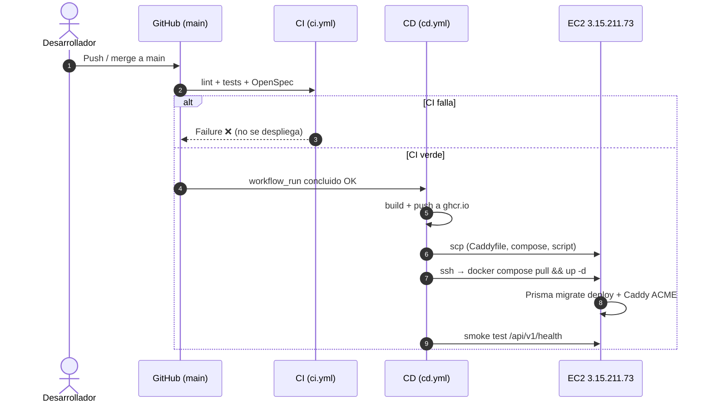

# Despliegue continuo en AWS (EC2 + Caddy + Docker Compose)

**Fecha:** 2026-11-03
**Dominio:** `https://clubdeportivo.alquilerespunilla.com.ar`
**Servidor:** `ubuntu@3.15.211.73` (EC2, Ubuntu, Docker 29.9.2 + Compose v5.6.1)
**Estado:** pipeline de CD actualizado (falla explícito si faltan secretos, valida el servidor, despliega con `--wait` y smoke test). Pendiente: cargar los secretos en GitHub y aprovisionar la EC2 una sola vez.

---

## 1. Decisiones tomadas

| Tema | Decisión |
|------|----------|
| DNS / Cloudflare | **DNS-only** (nube gris). Caddy emite y renueva el certificado de Let's Encrypt directamente contra la instancia. |
| Instancia | **Se mantiene la actual** (908 MB de RAM), agregando 2 GB de swap y evitando builds en el servidor. |
| Disparador del deploy | **Automático** en cada push/merge a `main` (CI verde → CD), sin aprobación manual. |

---

## 2. Diagnóstico verificado

| # | Hallazgo | Evidencia |
|---|----------|-----------|
| 1 | El job de deploy se saltea los tres pasos de SSH porque faltan secretos. Termina en verde y por eso "no hace nada". | Run CD `41559060854` (commit `8a4be0e`): pasos *Sincronizar archivos*, *Ejecutar despliegue remoto* y *Smoke test* = `skipped`; *Verificar configuración de secretos* = `success` con `configured=false`. |
| 2 | El servidor nunca fue aprovisionado. | `docker ps -a` vacío; no existe `/opt/club-deportivo`; nada escuchando en 80/443; `caddy` no instalado. |
| 3 | Aun con secretos, el primer `scp` fallaría. | `/opt` es `root:root 755`; `ubuntu` no puede crear `/opt/club-deportivo` y el `scp-action` no usa `sudo`. |
| 4 | Falta `.env.prod` en el servidor. | `deploy-aws.sh` solo advierte si no existe; `docker compose --env-file .env.prod` falla igual porque `docker-compose.prod.yml` exige `POSTGRES_PASSWORD` y `JWT_SECRET`. |
| 5 | El dominio no llega a la instancia. | Resuelve a IPs de Cloudflare (`104.21.66.77`, `172.67.157.129`) y responde `HTTP/2 521` (origen inalcanzable). |
| 6 | El último commit no disparó CI ni CD. | `6932b91` solo tocó `docs/` e `infra/`, incluidos en `paths-ignore`; no hubo CI y, al depender de `workflow_run`, tampoco CD. |
| 7 | Riesgo de OOM. | 908 MB de RAM, 0 B de swap; `docker-compose.prod.yml` conserva `build:` y un `pull` fallido dispararía un build de Next.js/Nest en el servidor. |
| 8 | Imágenes privadas en GHCR. | Manifest `401` sin credenciales; el workflow ya hace `docker login` con `GITHUB_TOKEN`. |

**Conclusión:** el pipeline está bien encaminado; faltan los secretos, el aprovisionamiento inicial del servidor y el DNS. La skill `github-actions-efficiency` es solo documentación de auditoría: no configura secretos ni despliega.

---

## 3. Flujo objetivo



---

## 4. Puesta en marcha

### 4.1. Secretos de GitHub (bloqueante)

Deben estar en **Settings → Secrets and variables → Actions → Secrets** (no en *Variables*) y como **repository secrets** (no *environment secrets* sin `environment:` en el job).

```bash
cd ~/Proyectos/IRESM/club-deportivo

gh secret set DEPLOY_HOST -R GasparNa/clubDeportivo --body "3.15.211.73"
gh secret set DEPLOY_USER -R GasparNa/clubDeportivo --body "ubuntu"
gh secret set DEPLOY_PORT -R GasparNa/clubDeportivo --body "22"
gh secret set DEPLOY_KEY  -R GasparNa/clubDeportivo < "$HOME/Documentos/IRESM/2026/IdS-II/club.pem"

gh secret list -R GasparNa/clubDeportivo
```

Cuidados con `DEPLOY_KEY`:

- Contenido completo del PEM, con `-----BEGIN ...-----` y `-----END ...-----`.
- Sin passphrase (la action no la maneja de forma simple).
- Si se pega en la UI, verificar que no queden `\n` literales.
- Debe ser la clave ya autorizada en `~/.ssh/authorized_keys` (verificado: hay una).

> Recomendación: a futuro, generar un par de claves exclusivo para deploy en lugar de reutilizar la personal.

### 4.2. Aprovisionamiento único del servidor

```bash
ssh -i "$HOME/Documentos/IRESM/2026/IdS-II/club.pem" ubuntu@3.15.211.73
```

```bash
# Directorio de la app (el scp-action no puede crearlo: /opt es de root)
sudo mkdir -p /opt/club-deportivo
sudo chown -R ubuntu:ubuntu /opt/club-deportivo

# Swap (la instancia tiene 908 MB y 0 B de swap)
sudo fallocate -l 2G /swapfile
sudo chmod 600 /swapfile
sudo mkswap /swapfile
sudo swapon /swapfile
echo '/swapfile none swap sw 0 0' | sudo tee -a /etc/fstab
free -h

# Variables de producción (no se versiona; el CD no la pisa)
cat > /opt/club-deportivo/.env.prod <<EOF
POSTGRES_DB=club_deportivo
POSTGRES_USER=club_deportivo
POSTGRES_PASSWORD=$(openssl rand -hex 24)
JWT_SECRET=$(openssl rand -hex 32)
JWT_EXPIRATION=24h
DB_CONNECTION_LIMIT=10
NEXT_PUBLIC_API_URL=https://clubdeportivo.alquilerespunilla.com.ar/api/v1
CORS_ORIGINS=https://clubdeportivo.alquilerespunilla.com.ar
EOF
chmod 600 /opt/club-deportivo/.env.prod

# Verificaciones
docker ps
docker compose version
id | grep docker
```

> `POSTGRES_PASSWORD` debe quedar fija: el volumen `pgdata` se inicializa con esa clave. No rotarla sin migrar la base.

### 4.3. DNS (Cloudflare, DNS-only)

1. Registro **A**: `clubdeportivo` → `3.15.211.73`.
2. Dejar la nube **gris (DNS only)**: Cloudflare solo resuelve, Caddy habla directo con Let's Encrypt.
3. Confirmar en el Security Group de AWS los puertos `22/tcp`, `80/tcp`, `443/tcp` y `443/udp`.
4. Verificar propagación:

```bash
dig +short A clubdeportivo.alquilerespunilla.com.ar   # debe devolver 3.15.211.73
curl -I http://clubdeportivo.alquilerespunilla.com.ar  # redirige a HTTPS cuando Caddy esté arriba
```

> Si en el futuro se activa el proxy de Cloudflare, poner **SSL/TLS → Full (strict)**. Nunca *Flexible* (loop de redirección con Caddy).

### 4.4. Primer despliegue

```bash
gh workflow run cd.yml -R GasparNa/clubDeportivo --ref main
gh run list -R GasparNa/clubDeportivo --workflow CD --limit 3
gh run watch <run-id> -R GasparNa/clubDeportivo
```

El `workflow_dispatch` construye, publica y despliega. A partir de ahí, cada merge a `main` con CI verde dispara el mismo flujo automáticamente.

Si algo falla:

| Paso que falla | Causa probable |
|----------------|----------------|
| `scp-action` | Permisos de `/opt/club-deportivo` (§4.2) |
| `ssh-action` | Clave, usuario, puerto o `authorized_keys` |
| `docker compose pull` | Login a GHCR (`GITHUB_TOKEN` con `packages: read/write`) |
| `docker compose up` | Falta `.env.prod` o variables obligatorias |
| Smoke test | DNS/Caddy/certificado o backend no healthy |
| Backend unhealthy | `docker compose logs backend` (migraciones Prisma con `RUN_MIGRATIONS=true`) |

---

## 5. Endurecimiento implementado

### 5.1. `.github/workflows/cd.yml`

- **Falla explícito si faltan secretos.** El paso *Verificar secretos de despliegue* recibe `DEPLOY_HOST`, `DEPLOY_USER` y `DEPLOY_KEY` por `env:` y termina con `exit 1` indicando cuáles faltan. Ya no existe el `configured=false` que salteaba el deploy en silencio.
- **Preflight del servidor** antes de copiar archivos: verifica que exista `/opt/club-deportivo`, que el usuario SSH pueda escribir, que exista `.env.prod` y que Docker Compose esté disponible. Los mensajes incluyen el comando de corrección.
- **Login a GHCR sin `|| true`**: si el token no sirve, el deploy falla en vez de continuar.
- **Smoke test público** con `--max-time` y reintentos contra `/api/v1/health`.

### 5.2. `scripts/deploy-aws.sh`

- `.env.prod` ausente es **error fatal** (antes solo advertía).
- Exige `BACKEND_IMAGE` y `FRONTEND_IMAGE` exportadas por el CD.
- Valida el compose con `docker compose config -q` antes de tocar contenedores.
- `docker compose pull` sin `||` (si no puede descargar, no sigue).
- `docker compose up -d --remove-orphans --wait --wait-timeout 180`: falla si un healthcheck no queda sano.
- `trap ERR` imprime `docker compose ps` y los últimos 50 logs de `caddy`, `backend` y `frontend`.

### 5.3. `docker-compose.prod.yml`

- Se eliminaron los bloques `build:` de `backend` y `frontend`: el servidor solo descarga imágenes de GHCR.
- `pull_policy: always` en todos los servicios.
- `image:` con default a las imágenes de GHCR (`ghcr.io/gasparna/clubdeportivo/...:latest`): el CD las sobrescribe con `BACKEND_IMAGE`/`FRONTEND_IMAGE`, y `deploy-aws.sh` exige que estén definidas antes de desplegar. Así `docker compose ps`/`logs` funcionan en operación sin exportar variables.
- Rotación de logs (`max-size: 10m`, `max-file: 3`) en los cuatro servicios para no llenar el disco de 24 GB.
- `start_period` de backend y frontend ampliado a 30 s (instancia lenta).

### 5.4. `ci.yml`

- Se agregó `prisma generate` + `typecheck` del backend antes de los tests.
- Se agregó `docker compose -f docker-compose.prod.yml config -q` con variables dummy para detectar regresiones de sintaxis en el compose de producción.
- Se mantiene `paths-ignore`: commits solo de documentación no disparan CI ni CD. Para forzar un despliegue, usar `workflow_dispatch`.

### 5.5. Documentación del repo

`AGENTS.md` y `README.md` se actualizaron a la realidad: `ci.yml` + `cd.yml` con EC2 + Caddy + Compose. `docs/despliegue-aws.md` (App Runner/Terraform) queda como referencia histórica y `infra/terraform/` como legado no aplicado.

> Nota: con la instancia de 908 MB, el `pull` debe ser la única vía de obtener imágenes. Un build accidental de Next.js puede tumbarla; por eso se quitó `build:` del compose de producción.

---

## 6. Operación normal

```bash
# Ver últimos deploys
gh run list -R GasparNa/clubDeportivo --workflow CD --limit 5

# Ver estado en el servidor
ssh -i "$HOME/Documentos/IRESM/2026/IdS-II/club.pem" ubuntu@3.15.211.73 \
  'cd /opt/club-deportivo && docker compose -f docker-compose.prod.yml --env-file .env.prod ps'

# Logs
ssh -i "$HOME/Documentos/IRESM/2026/IdS-II/club.pem" ubuntu@3.15.211.73 \
  'cd /opt/club-deportivo && docker compose -f docker-compose.prod.yml --env-file .env.prod logs --tail 100 backend caddy'

# Health público
curl -fsS https://clubdeportivo.alquilerespunilla.com.ar/api/v1/health
```

---

## 7. Rollback

- **Aplicación:** redeploy de un tag anterior (`sha-<corto>`) exportando `BACKEND_IMAGE` y `FRONTEND_IMAGE`, y ejecutando `deploy-aws.sh`. Las imágenes quedan en GHCR.
- **Base de datos:** las migraciones Prisma son forward-only. Antes de un cambio de esquema, `pg_dump` del volumen y restaurar si hace falta.
- **DNS:** volver el registro A al origen anterior en Cloudflare.

---

## 8. Checklist de aceptación

- [ ] `gh secret list` muestra `DEPLOY_HOST`, `DEPLOY_USER`, `DEPLOY_KEY` (y `DEPLOY_PORT`).
- [ ] `/opt/club-deportivo` existe y pertenece a `ubuntu`.
- [ ] `/opt/club-deportivo/.env.prod` existe con permisos `600`.
- [ ] Swap de 2 GB activo (`free -h`).
- [ ] `dig +short A clubdeportivo.alquilerespunilla.com.ar` → `3.15.211.73`.
- [ ] El run de CD tiene *Sincronizar*, *Ejecutar despliegue remoto* y *Smoke test* en `success` (no `skipped`).
- [ ] `docker compose ps` → `caddy`, `db`, `backend`, `frontend` en `running/healthy`.
- [ ] `curl -fsS https://clubdeportivo.alquilerespunilla.com.ar/api/v1/health` → `200` con `status: ok`.
- [ ] `https://clubdeportivo.alquilerespunilla.com.ar/login` carga el frontend.
- [ ] Certificado TLS válido y renovación automática en los logs de Caddy.
- [ ] Un merge posterior a `main` vuelve a desplegar sin intervención.
