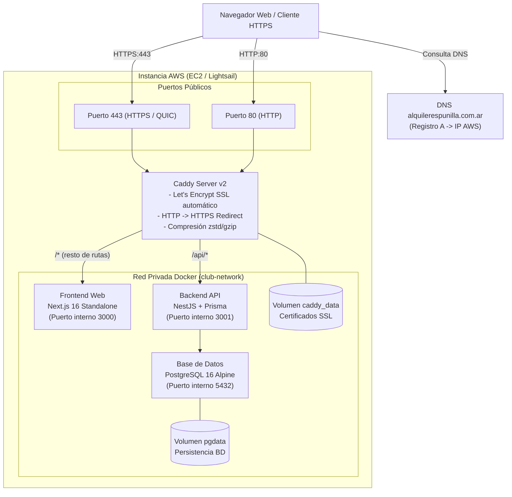
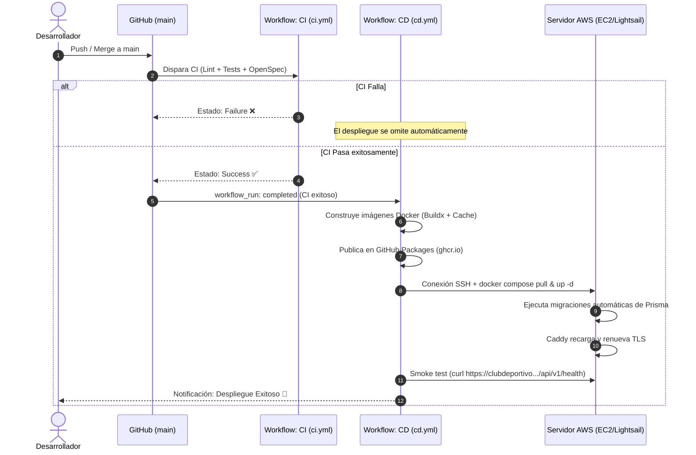

# Propuesta de Despliegue: AWS con Caddy y Docker Compose

**Dominio objetivo:** `https://clubdeportivo.alquilerespunilla.com.ar/`  
**Fecha:** Noviembre 2026  
**Estado:** Propuesta técnica y arquitectura de referencia aprobada para implementación.

---

## 1. Resumen Ejecutivo

Esta propuesta reemplaza la arquitectura histórica híbrida (Vercel + Render + Supabase) y la opción preliminar de AWS App Runner (discontinuada por AWS para nuevos clientes desde octubre de 2026).

La nueva solución consolida toda la infraestructura en **AWS** mediante una arquitectura de contenedores **Docker Compose** gobernada por **Caddy** como Reverse Proxy y terminador TLS automático para el dominio `clubdeportivo.alquilerespunilla.com.ar`.



---

## 2. ¿Por qué AWS con Caddy (y no Vercel ni App Runner)?

| Criterio | Despliegue anterior (Vercel + Render) | AWS App Runner | **Propuesta: AWS + Caddy + Compose** |
|---|---|---|---|
| **Disponibilidad AWS** | Fragmentado en múltiples nubes | **Cerrado a nuevas cuentas** por AWS (octubre 2026) | **100% disponible** en cualquier cuenta AWS (EC2 / Lightsail) |
| **CORS & Dominios** | Problemas frecuentes de CORS por orígenes cruzados (`.vercel.app` vs `.onrender.com`) | Requiere configuración de orígenes y cabeceras cruzadas | **Cero problemas de CORS**: Frontend y Backend operan bajo el mismo dominio (`clubdeportivo.alquilerespunilla.com.ar`) |
| **Gestión SSL / TLS** | Certificados automáticos pero separados | Gestionado por AWS con validación ACM | **Automático con Let's Encrypt vía Caddy**, con renovación transparente y soporte HTTP/3 (QUIC) |
| **Costo mensual estimado** | Tier gratuito inestable o ~$27/mes combinando planes de pago | ~$45–$55/mes (App Runner + RDS + ECR) | **~$10–$15/mes** (Lightsail 2GB o EC2 t4g.small / t3.small) |
| **Simplicidad de CI/CD** | Múltiples webhooks e integraciones disjuntas | Complejo: requiere sincronización multietapa | **Pipeline unificado en GitHub Actions** que valida CI y despliega con SSH |

---

## 3. Componentes de la Arquitectura

### 3.1. Reverse Proxy con Caddy (`Caddyfile`)
Caddy actúa como la puerta de enlace segura (ingress gateway):
- **Certificados SSL automáticos:** Negocia y renueva certificados válidos de Let's Encrypt o ZeroSSL para `clubdeportivo.alquilerespunilla.com.ar`.
- **Enrutamiento por prefijo:**
  - `https://clubdeportivo.alquilerespunilla.com.ar/api/*` se deriva internamente al servicio `backend:3001`.
  - El resto del tráfico (`/*`) se deriva al servicio `frontend:3000`.
- **Seguridad perimetral:** Ni el backend ni la base de datos exponen puertos a Internet; únicamente los puertos 80 y 443 de Caddy son accesibles desde el exterior.

### 3.2. Cómputo en AWS (Opciones recomendadas)

#### Opción A: AWS Lightsail (Recomendada para máxima simplicidad y costo fijo)
- **Instancia:** Linux Ubuntu 24.04 LTS (2 GB RAM, 2 vCPUs, 60 GB SSD).
- **Costo:** **USD $10/mes**.
- **Ventajas:** Incluye 3 TB de transferencia mensual, IP estática sin cargo adicional, firewall integrado en la consola de Lightsail y aprovisionamiento en 2 minutos.

#### Opción B: AWS EC2 (`t4g.small` ARM64 Graviton2 o `t3.small` x86_64)
- **Instancia:** `t4g.small` (2 vCPUs, 2 GB RAM) con disco EBS gp3 de 30 GB.
- **Costo:** ~$12–$14 USD/mes.
- **Ventajas:** Integración directa con VPC, Security Groups estándar y posibilidad de migrar a RDS si la carga de datos lo requiere a futuro.

---

## 4. Pipeline de CI/CD en GitHub Actions

El ciclo de vida del código sigue el principio estricto de **entrega continua condicionada**:



### Características clave del pipeline:
1. **CI Eficiente (`.github/workflows/ci.yml`):**
   - Filtrado de rutas con `paths-ignore`: cambios en documentación (`.md`, `docs/`) o infraestructura (`infra/`) no gastan minutos de runner.
   - Concurrencia segura: `cancel-in-progress: ${{ github.ref != 'refs/heads/main' }}`. Cancela builds obsoletos en ramas y PRs pero protege las ejecuciones en `main`.
2. **CD Condicionado (`.github/workflows/cd.yml`):**
   - Se ejecuta únicamente si `workflow_run.conclusion == 'success'` en la rama `main`.
   - Soporta ejecución manual de emergencia mediante `workflow_dispatch`.

---

## 5. Configuración DNS del Dominio

Para vincular `https://clubdeportivo.alquilerespunilla.com.ar/`:

1. En el panel de control DNS del registrador de `alquilerespunilla.com.ar` (ej. Nic.ar, DonWeb, Cloudflare, etc.):
2. Crear un registro de tipo **A**:
   - **Host / Nombre:** `clubdeportivo`
   - **Tipo:** `A`
   - **Valor:** `<IP_ESTATICA_PUBLICA_DE_AWS>`
   - **TTL:** 300 o Automático
3. Una vez propagado el DNS, Caddy completará el handshake ACME con Let's Encrypt de manera 100% automática en la primera petición HTTP.

---

## 6. Variables de Entorno y Secretos

### Secretos en GitHub (Settings → Secrets and variables → Actions):
- `DEPLOY_HOST`: IP pública de la instancia AWS.
- `DEPLOY_USER`: Usuario SSH (ej. `ubuntu`).
- `DEPLOY_KEY`: Llave privada SSH (formato PEM / OpenSSH) autorizada en `~/.ssh/authorized_keys` del servidor.
- `DEPLOY_PORT`: Puerto SSH (opcional, por defecto 22).

### Variables en el servidor (`/opt/club-deportivo/.env.prod`):
```bash
POSTGRES_DB=club_deportivo
POSTGRES_USER=club_deportivo
POSTGRES_PASSWORD=<password_robusto_generado>

JWT_SECRET=<clave_secreta_jwt_minimo_32_caracteres>
JWT_EXPIRATION=24h
DB_CONNECTION_LIMIT=10

NEXT_PUBLIC_API_URL=https://clubdeportivo.alquilerespunilla.com.ar/api/v1
CORS_ORIGINS=https://clubdeportivo.alquilerespunilla.com.ar
```

---

## 7. Procedimiento de Puesta en Marcha Inicial

1. **Aprovisionar la instancia en AWS:**
   - Crear instancia Ubuntu 24.04 (Lightsail o EC2).
   - Asignar IP estática / Elastic IP.
   - Abrir en el firewall: TCP 80, TCP 443, UDP 443 y TCP 22.

2. **Instalar Docker en el servidor:**
   ```bash
   ssh ubuntu@<IP_PUBLICA>
   sudo apt-get update && sudo apt-get install -y docker.io docker-compose-v2
   sudo usermod -aG docker ubuntu
   newgrp docker
   sudo mkdir -p /opt/club-deportivo && sudo chown -R ubuntu:ubuntu /opt/club-deportivo
   ```

3. **Copiar archivos base y arrancar:**
   ```bash
   cd /opt/club-deportivo
   # Copiar Caddyfile, docker-compose.prod.yml y .env.prod
   docker compose -f docker-compose.prod.yml --env-file .env.prod up -d
   ```

4. **Verificación:**
   ```bash
   curl -I https://clubdeportivo.alquilerespunilla.com.ar/api/v1/health
   # Debe responder HTTP/2 200 OK con TLS válido
   ```
